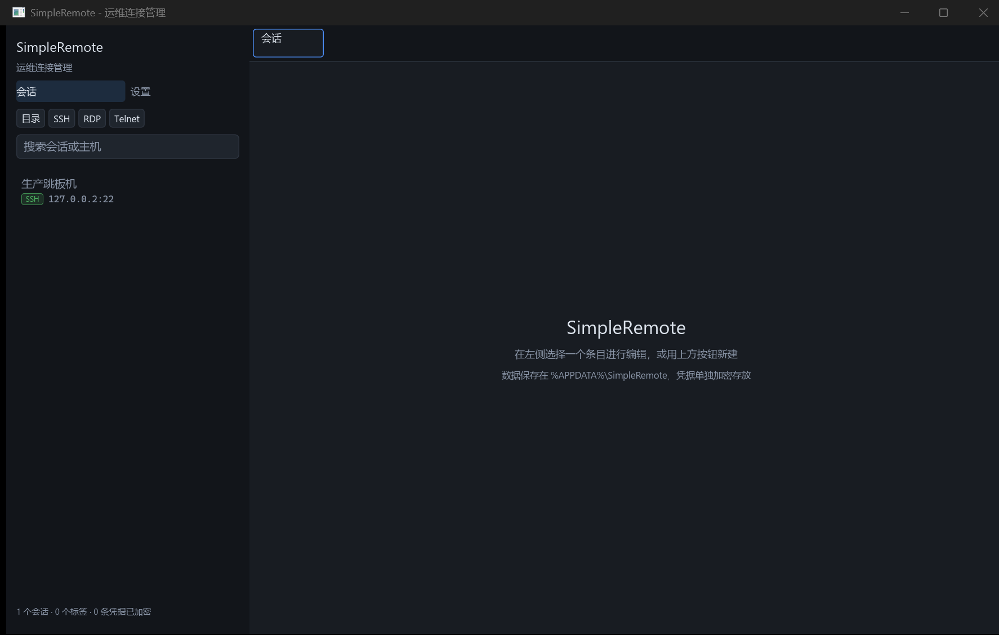
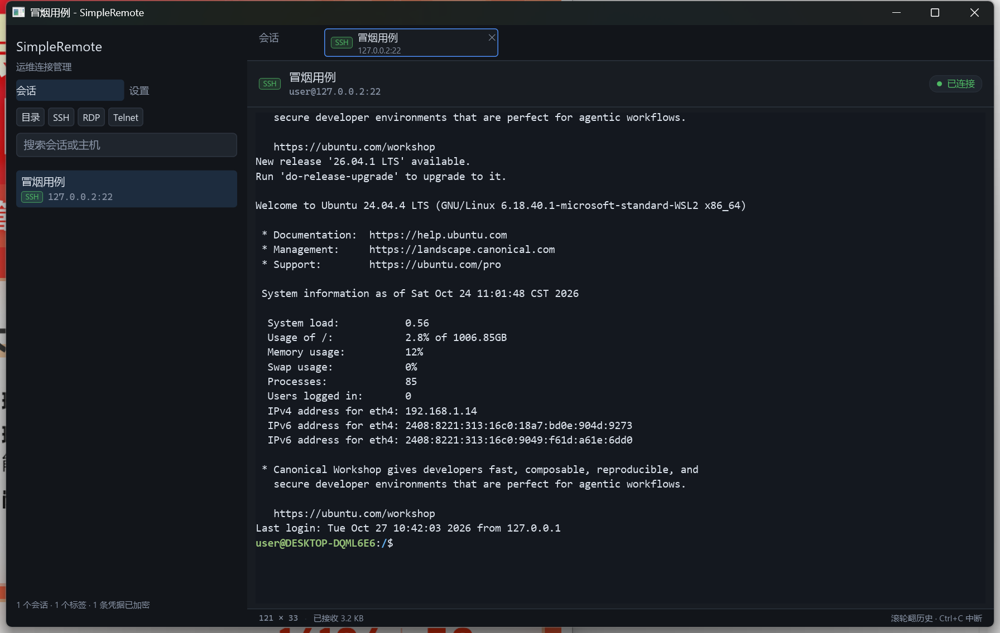
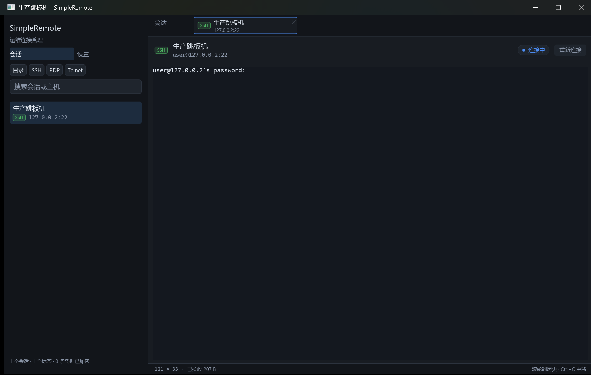

# SuperRemote · 远程连接管理

> 前身是 C# / WPF 的 SimpleRemote（1.2，2019 年后停更），代码已整体移除；旧版只作为行为参考，
> 源码见上游仓库 [beckzhu/SimpleRemote](https://github.com/beckzhu/SimpleRemote)。

本仓库是**从零开始的等价重写**，不是移植：领域模型、存储格式、终端引擎全部按 Rust 生态重新选型，
界面用 Iced 0.14 的 Elm 架构重做。

```
cargo build --release -p superremote-app        # → target/release/SuperRemote.exe（build.rs 调 .NET Framework csc 编译 RDP 宿主）
```

发布包由 GitHub Actions 在打 tag 时构建（`.github/workflows/release.yml`）：
推送 `v2.0.0` 这类 tag 就会生成 `SuperRemote-windows-x64.zip` 并挂到 Release 上，
里面只有 `SuperRemote.exe` + `LICENSE` + `README.md`，解压即用（配置写在 exe 旁边的 `data/`）。

---

## 1. 现在能做什么

| 能力 | 状态 | 说明 |
| --- | --- | --- |
| 会话树增删改、展开状态 | 完成 | 与 C# 版一致的分组/叶子两层结构；拖拽/复制粘贴尚未接回 |
| 搜索（名称/主机/账号） | 完成 | 边输入边过滤，命中项高亮 |
| 凭据加密保存 | 完成 | AES-256-GCM；DEK 由 DPAPI 包裹，或改主口令（Argon2id） |
| SSH 登录 + 交互式终端 | 完成 | ConPTY + 系统 `ssh.exe`，支持口令代填、私钥登录、断线重连 |
| Telnet 登录 + 交互式终端 | 完成 | 原生 TCP，最小 NVT 协商（ECHO/SGA/TTYPE/NAWS） |
| 多标签、同一会话多开 | 完成 | 标签以 `TabId`（运行实例）索引，不再以 `SessionId` 索引 |
| 终端渲染（颜色、CJK 宽字符、光标、滚轮回看） | 完成 | canvas 两遍绘制；字体（下拉列系统等宽字体）/字号/光标/配色（5 套内置）可按连接覆盖；字符集支持 GBK/Big5/Latin-1 转码 |
| 终端选择、复制、粘贴 | 完成 | 鼠标拖选 + Ctrl+Shift+C/V + 右键粘贴 |
| 窗口尺寸同步到远端 | 完成 | Iced `update` 里发 `WindowResized` → `TIOCSWINSZ` 等价消息 |
| 每连接设置 + 全局默认继承 | 完成 | 单连接覆盖 → 全局默认 → 程序默认逐项回退；支持重置与设为默认。设置页有「远程桌面默认」「打开方式默认」「终端默认」三张卡，全局默认可直接改 |
| 首选打开方式 | 完成 | 每条连接可存「选项卡 / 后台选项卡 / 独立窗口」，双击、回车与详情页的「打开连接」按偏好落位；右键菜单里的三项仍是显式指定。没设过的连接走全局默认 |
| 独立窗口尺寸记忆 | 完成 | 关独立窗口时把尺寸写回该连接（`config.toml` 的 `window` 表），下次「在新窗口打开」直接复用；没记录过时用 980×660 |
| RDP 分辨率（含全屏档） | 完成 | 跟随窗口 / 全屏（打开即全屏，取主屏分辨率）/ 系统枚举出的显示模式（`EnumDisplaySettingsW`）并入预置档；固定档位按 1:1 呈现，内容区装不下时出水平/垂直滚动条，见 §5 |
| 亮/暗主题、跟随系统 | 完成 | `theme::Palette` 是唯一色源，视图层不出现字面色值；暗色对比度由单测守住 |
| 中英双语 | 完成 | `i18n::T` 是字段表，漏一条编译期报错；语言与主题都写进 `config.toml` 的 `[ui]` |
| RDP | 可用（内嵌标签 + 设置项） | 内置 C# ActiveX 宿主直连（不走 `.rdp`），设置 `RedirectionWarningDialogVersion=1`/`AuthenticationLevel=0`；`CredWrite`/`CredRead` 凭据；分辨率/颜色/音频/组合键/重定向可配，见 §5 |
| 右键菜单 | 完成 | 会话树/连接列表：打开（含后台、独立窗口）、新建 RDP/SSH/Telnet/目录、剪切/复制/粘贴、重命名、复制地址、删除；空白处新建到根层或粘贴。标签：重连、全屏（RDP）、断开（RDP）、在独立窗口打开、关闭、关闭其他。走 `overlay::menu`，菜单状态在控件自己的 `Tree` 里（`view` 是不可变借用） |
| 拖拽移动 | 完成 | 树节点拖到目录里、拖到连接旁边、拖到空白处回根层；目录不能拖进自己下面。落点行有高亮，展开状态跟着子树走 |
| 后台标签 | 完成 | 「在后台打开」建标签并连接，但不抢焦点；首个后台打开仍会落位，否则停在空壳视图上 |
| 快捷键（标签） | 完成 | `Ctrl+Tab` / `Ctrl+Shift+Tab` 切标签、`Ctrl+1…8` 跳第 N 个、`Ctrl+9` 跳最后、`Ctrl+Shift+W` 关标签。刻意不抢 `Ctrl+W`/`Ctrl+K` 这类 shell 编辑键 |
| 独立窗口 | 完成 | 「在新窗口打开」把会话放进独立窗口（标题条可拖拽 + 状态 + 关闭）。SSH/Telnet 是完整终端；**RDP 画面内嵌进独立窗口**（对齐旧版 `RemoteWinControl`），打开即连接。入口：树右键 / 标签右键 |
| 新建连接标签 | 完成 | 标题栏「+」打开一个新建连接标签：与右键「新建 SSH」同一套完整详情编辑器（身份认证 + 协议设置），保存后连接成真实会话标签；关闭空草稿会自动删掉节点 |
| 无边框窗口与自绘标题栏 | 完成 | `decorations: false` + 38px 标题条（品牌 logo / 标签条 / 最小化·最大化·关闭）+ 四边四角缩放热区 + 1px 窗口描边；标签条在标题栏里，活动标签是浅灰底 + 强调色下划线；会话页整窗铺开，终端底部一条 26px 状态条 |
| 应用图标与品牌标 | 完成 | 标题栏 20px、解锁/致命错误页 48–64px 显示 logo 原图；任务栏、Alt-Tab 与 exe 图标共用同一份像素（128×128 RGBA + `icon.ico`），换 logo 只需改资源并重新生成 `icon-128.rgba` |
| 图标悬停提示 | 完成 | 导航（主页/连接列表/设置）、窗口按钮、标签 ✕/`＋`、口令长按、提示条关闭均有 350ms 延迟的 tooltip |
| 连接列表页 | 完成 | 图标栏第二项：平铺全部 RDP / SSH / Telnet 连接，可搜索；点一行回主页详情，右侧「打开」直接建标签 |
| 详情页版式 | 完成 | 终稿 E1+：56px 图标栏 + 260px 连接列表 + 内容区；两张可折叠分组（身份认证 / 远程连接），控件统一 400 宽、标签列 88，分组级按钮缩进到控件列，页面级按钮固定 52px 操作条；默认 1180×760 一屏放下、不出滚动条 |
| 按钮组件 | 完成 | 带文字的按钮统一走 `ui::button`（主 / 次 / 危险三种层级，共用 `[6,14]` 内边距、12px 字、1px 描边、6px 圆角）；图标按钮走 `ui::button::icon`，统一吃满格子并居中 |
| 托盘、开机自启、自动更新 | 未做 | 原版这三块深度绑定 Win32/COM，优先级最低 |



真实 SSH 登录后的终端页（127.0.0.2，WSL2 Ubuntu 24.04），正文、光标、底部状态条：



未保存口令时会话停在远端提示上——提示直接显示在终端里，可以直接输入，
「重新连接」保持同位置灰态：



---

## 2. 分层

```
superremote-core   领域层：会话树、搜索、标签规则。不依赖 iced，也不依赖 Windows。
superremote-store  持久化：config.toml + secrets.toml，原子写入，损坏文件自愈。
superremote-term   终端内核：alacritty_terminal 的网格 + VTE 解析，物化成可绘制的 Frame。
superremote-net    连接层：SSH / Telnet 后台线程，双向通道（Command / NetEvent）。
superremote-app    Iced 前端：App 状态机 + 视图 + canvas 终端。bin 名 SuperRemote。
```

依赖方向严格单向：`superremote-app → {core, store, term, net}`，`net/term → core`，`store → core`。
`superremote-core` 以下没有任何 UI 概念，因此领域规则可以完全脱离窗口单测。

### 2.1 为什么连接跑在线程里而不是 `async`

界面侧要的是「同步、可单测」的 `update`。所以连接层不暴露 future：

- 打开连接 → 起一个线程，持有 ConPTY/TCP，自己阻塞读。
- 界面 → 连接：`Command::Write / Resize / Close`。
- 连接 → 界面：`NetEvent::Data / Ready / Exited / Error`，先进队列。
- `App::subscription` 在存在未结束连接时挂 16ms 的 `NetPoll`，`update` 里 `Hub::drain()` 取事件。

好处是整条「按键 → 字节 → 远端 → 回显 → 网格」链路在 `tests/smoke.rs` 里可以无窗口跑完；
代价是多两个线程和一层队列，对这个规模的应用完全值。

### 2.2 为什么用系统 `ssh.exe` 而不是 `russh`

`russh` 的加密后端只有两条路：`aws-lc-rs`（要 cmake + NASM）或 `ring`（要 NASM）。
本机工具链只有 `cl.exe`/`link.exe`/`cmake`，两条都不通。改用 ConPTY 拉起系统 OpenSSH 后，
反而白拿了 `known_hosts`、`ProxyJump`、系统代理、密钥链、`~/.ssh/config` 这些原生能力，
代价是依赖机器上存在 `ssh.exe`（Win10 1809+ 自带）。

---

## 3. 数据与安全

只有两个文件，默认在**程序目录的 `data` 下**（便携）；设置页可以改到任意目录，旧的 AppData 数据首次启动会自动复制过来并保留备份。测试用 `SUPERREMOTE_DATA_DIR` 隔离：

- `config.toml`：`schema` 版本、会话树、展开状态、`[security]`。明文，可手改可备份。
- `secrets.toml`：`条目 id → hex(nonce ‖ 密文 ‖ tag)`。除密文外不落任何凭据信息。

**任何口令都不进 `config.toml`。** 写入统一走临时文件 + 改名覆盖，断电不会留半截文件。
读不懂的文件会改名保留成 `*.toml.broken-<unix秒>` 再从空配置启动并提示；
但发现 `schema` 比程序支持的更新时**只报错、不改写**，避免新版本配置被旧版本抹掉。

口令模型是 DEK/KEK 两层，换口令只重包 DEK，`secrets.toml` 不动。DPAPI 调用带固定附加熵
`SimpleRemote-dpapi-v1`，DEK 的 AAD 同样是 `SimpleRemote-dek-v1`。这两个是历史域分隔常量，
**不是漏改的产品名**：改掉会让已有密文全部解不开，因此这两个常量继续沿用旧值。

---

## 4. 测试与验证

```bash
cargo test --workspace                  # 214 个用例
cargo clippy --workspace --all-targets  # 无自身告警
```

| 范围 | 用例数 | 验的是什么 |
| --- | --- | --- |
| `superremote-core` | 37 | 会话树增删改、搜索、标签规则、RDP/终端设置继承、落盘码往返 |
| `superremote-store` | 38 | 原子写入、损坏自愈、DPAPI 与主口令两条包裹路径、设置/默认/私钥往返 |
| `superremote-term` | 15 | VTE 解析、CJK 宽字符不串位、resize 裁剪、回看缓冲、配色方案（含每套方案前景/背景可分辨） |
| `superremote-net` | 11 | 假 telnet 服务端回环、NAWS 协商、口令代填计数、关闭语义、SSH 参数 |
| `superremote-net`（集成） | 2 | 真实 SSH 登录、口令错误必须结束会话（缺环境变量时跳过） |
| `superremote-app`（单元） | 96 | 键入编码、提示符判定、键盘接管边界、字体步进量测、系统等宽字体枚举、字体/配色下拉选项、文本段合并、RDP 窗口几何与分辨率呈现、设置持久化、选择区 |
| `superremote-app`（冒烟） | 2 | 见下 |
| `superremote-app`（无窗口渲染） | 9 | 品牌标像素、右键菜单/提示/toast/描边的逐像素对拍、设置页中英文版式一致 |
| `vendor/iced_tiny_skia` | 4 | 脏区扩张、包围盒合并与不合并的边界 |

集成测试需要真实 SSH 目标，缺少环境变量时自动跳过（`cargo test --workspace` 因此永远是绿的）：

```bash
SUPERREMOTE_SSH_HOST=127.0.0.2 SUPERREMOTE_SSH_PORT=22 SUPERREMOTE_SSH_USER=user SUPERREMOTE_SSH_PASS=****** \
  cargo test -p superremote-net --test ssh_live -- --nocapture --test-threads=1

SUPERREMOTE_SSH_HOST=127.0.0.2 SUPERREMOTE_SSH_PORT=22 SUPERREMOTE_SSH_USER=user SUPERREMOTE_SSH_PASS=****** \
SUPERREMOTE_SMOKE_DIR="$(pwd)/target/smoke-data" \
  cargo test -p superremote-app --test smoke -- --nocapture --test-threads=1
```

> 冒烟用例之间**必须**用互不相同的数据目录（`data_dir(tag)` 已经这么做了）。
> `cargo test` 默认并行跑，共用一个目录会互相 `remove_dir_all`，表现成随机 40s 超时——
> 这个坑踩过一次，别再退回去。

- `ssh_live.rs`：真登录 → 执行命令读回输出 → 改窗口尺寸后远端 `stty size` 收敛到 `30 100`；
  以及「口令错误必须结束会话，不能挂着」。
- `smoke.rs#a_real_ssh_session_...`：走完整 UI 状态机——造会话 → 点「打开连接」→ 等到 `Live`
  且提示符出现 → 键入 `printf 'SMOKE-%s\n' ok` → 等到回显 `SMOKE-ok` → 改尺寸校验网格是 30×100 → 关标签。
- `smoke.rs#an_unsaved_password_...`：**故意不存口令**建会话，等到屏幕出现 `password:`，
  断言此时「还没连上但已经接管键盘」，再逐字敲入口令，验证能真正登录进 shell。
  这条守的是「不保存口令的会话不能变成死路」。

### 4.1 关于 `user1`

蓝图里给的账号是 `user1`，**该账号在目标机上不存在**。真机确认可用的是 `user` 与 `root`
（口令有效，目标是 WSL2 Ubuntu 24.04 + OpenSSH 9.6）。所有测试与截图都用 `user`。

### 4.2 已知行为：窗口尺寸会延迟合并

ConPTY 侧收到 resize 一定立刻生效，但 Windows 版 OpenSSH 会合并/延迟转发 window-change，
所以远端 `stty size` 常常第一次读到的是上一轮的旧值。集成测试因此改成「轮询 5 次直到收敛」断言，
这也解释了为什么手动拖拽窗口后远端换行会慢半拍。属于 OpenSSH 行为，不在本项目可控范围。

### 4.3 口令与终端的接管边界

一条会话的键盘归属由 `Terminal::accepts_input()` 决定，规则是：

| 状态 | 键盘归终端 | 理由 |
| --- | --- | --- |
| `Live` | 是 | 已进 shell |
| `Connecting` 且已收到输出 | 是 | 远端可能停在 `password:`，必须能手输 |
| `Connecting` 且一片空白 | 否 | 还没画面可看，别抢搜索框的输入 |
| `Closed` / `Failed` | 否 | 会话已死，把键盘还给界面 |

配套的视图规则：**只要终端收到过字节，就显示终端画面，不再用提示页覆盖**。
否则 `password:` 提示会被「正在连接…」挡住，`ssh` 的报错也会被「连接失败」吃掉——
用户看到的永远是一个笼统的失败，却看不到真正原因。

---

## 5. 取舍记录

**RDP 画面由内置 ActiveX 宿主直连。** 旧项目用 `AxMsRdpClient9`；新版本保留同一套直连逻辑，但宿主是独立的 C# 小进程（`crates/superremote-app/host/Program.cs`，build.rs 用 `csc.exe` 编译并嵌进 Rust exe）。它不生成 `.rdp` 文件，连接前设置 `RedirectionWarningDialogVersion=1`（C# 必须是 `VT_UI4`）与 `AuthenticationLevel=0`，所以 2026-04 新增的「未签名 `.rdp` 文件」确认框不会出现，重定向也按设置生效。密码仍由 Rust 写入系统凭据管理器，宿主用 `CredReadW("TERMSRV/<host>")` 取；不经过命令行或临时文件。宿主窗口先出现在屏幕外，Rust 按 PID + `SUPERREMOTE|` 标题前缀找到后 `SetParent` 进标签，标题里的 `connected`/`failed` 是状态通道；`rdp_host::PaneLayout` 的贴边常量仍必须与 `ui::TITLEBAR_H` 同步。宿主是 Per-Monitor V2，与 Iced 父窗口一致，避免光标大小抖动。运行前提是 .NET Framework 4.8（Windows 10/11 自带），构建需要 `csc.exe`。实现见 `crates/superremote-app/src/rdp.rs`、`crates/superremote-app/src/rdp_host.rs` 与 `host/Program.cs`。

**固定分辨率按 1:1 画，装不下就出滚动条。** 连接设置里的「分辨率」选固定值（例如 1920×1080）时，远端桌面就是这个尺寸，不会被缩放到标签内容区大小：内容区比它小，控件按系统滚动条给出水平/垂直方向（与旧版一致——旧版从没设过 `SmartSizing`，默认就是关）；内容区比它大，画面居中、四周留黑，不拉伸。选「跟随窗口」或「全屏」时才开着 `SmartSizing`，画面铺满内容区。这条开关由 `rdp::activex_smart_sizing` 算出，经 `--smart-sizing` 传给宿主。

**设置是「单连接覆盖 → 全局默认 → 程序默认」三层。** `config.toml` 的 `[defaults.rdp]` /
`[defaults.terminal]` 存全局默认，每个 session 的 `settings` 表只存显式覆盖；`None`/空字段
逐项回退。枚举值存字符串，未来新增档位时旧程序只忽略这一项而不是把整份配置判坏。
RDP 的设置映射到 `activex_args` / 宿主属性；终端的字体、字号、光标、回退键、Home/End、字符集、鼠标动作、功能键
与配色在连接时固化成快照，改完需要重新连接。实现见 `superremote-store/src/document.rs`、
`superremote-core/src/session.rs` 与 `superremote-app/src/rdp.rs`。

**渲染后端默认软件渲染。** `tiny-skia` 默认档实测（Win11 + AMD 780M + 1180×720 空载）：
工作集 26–29MB、exe 4.93MiB；切 `gpu`（wgpu）后约 160MB、exe 7MB，成像一致。（exe 体积 2026-11-02 重测为 4.93MiB；工作集那组是更早量的，没重测。）
原版的卖点是「轻量单文件」，所以默认走软件渲染，`gpu` 作为可选特性保留。

**字体步进按连接量一次。** 等宽网格要求 `cell_width` 是整数像素，每次绘制都量一次会抖。
每个终端在创建时用 `cosmic-text` 按所选字体/字号量一次步进；改字体或字号后需要重新连接，
新的度量会随重连生效。默认仍是 Consolas 13px。

**字体下拉列的是系统真装了的等宽字体。** `superremote-app/src/fonts.rs` 用 `EnumFontFamiliesExW`
过一遍 GDI，只留固定字距的族（网格按一个字宽排所有列，比例字体会互相压叠），结果缓存在
进程级 `OnceLock` 里；非 Windows 目标没有 GDI，退回 5 个常见等宽字体名。配置里存着但没被
枚举到的名字（手改过 `config.toml`，或那个字体不是等宽）会作为「（自定义）」一项出现在末尾，
下拉不会把实际生效的字体显示成别的。

---

## 6. 仓库结构

```text
Cargo.toml     工作区根（resolver = 2）；单文件分发的 release profile 也在这里
Cargo.lock
crates/
  superremote-core/     领域层：会话树、搜索、标签规则
  superremote-store/    持久化：config.toml + secrets.toml
  superremote-term/     终端内核：VTE 网格与 Frame 物化
  superremote-net/      连接层：SSH / Telnet 后台线程
  superremote-win/      Win32 绑定：窗口/布局/字体/剪贴板/生僻系统调用
  superremote-app/      Iced 前端（bin 名 SuperRemote）
vendor/        打过脏区补丁的 iced_tiny_skia 副本（见 §5）
docs/          截图 + 架构蓝图（architecture-blueprint.md）
.github/       CI 与发行流水线（tag 触发构建、打包、发 Release）
```

数据格式与旧版不通用（旧版 LiteDB + XML，新版 TOML），有意为之：新格式可手改、可 diff。
需要迁移时单独写一次性导入工具，不塞进主程序。

更多协作约定（代码风格、提交要求、禁止操作）见仓库根目录 `AGENTS.md`。
